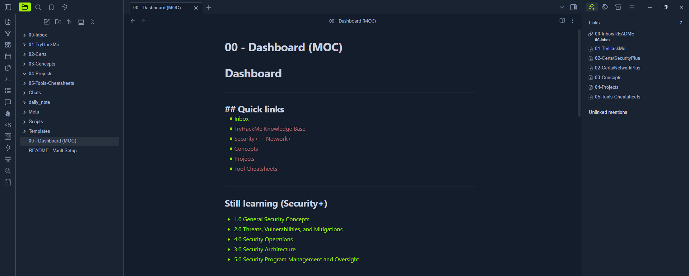
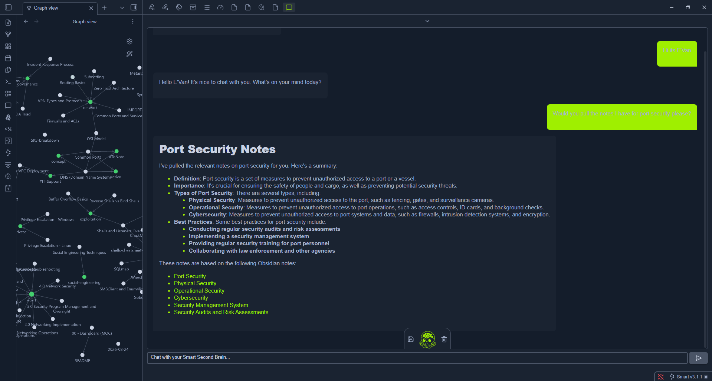
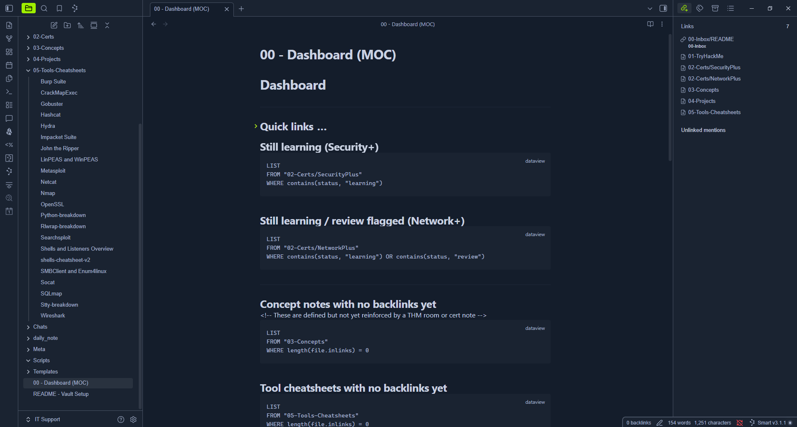

# AI-Powered Security Knowledge Base

A local-first Obsidian vault for organizing security certification study, hands-on lab work, and technical reference material — with an integrated offline AI assistant powered by Ollama.

This repository contains my portfolio site and project screenshots. The vault layout below illustrates how I organize my Obsidian knowledge base.

## Why I Built This

I built this searchable knowledge base while preparing for CompTIA Network+. I earned Network+ in January 2026 and continue using the vault for Security+ study and hands-on TryHackMe labs.

## Screenshots





## Stack

- **[Obsidian](https://obsidian.md/)** — note-taking and linking engine
- **[Ollama](https://ollama.com/)** — local LLM runtime, fully offline
  - `llama3.1:latest` — general-purpose reasoning and Q&A over notes
  - `mistral:latest` — alternate model for comparison/fallback
  - `qwen2.5:0.5b` — lightweight model for fast, low-resource queries
  - `nomic-embed-text:latest` — embeddings for semantic search across the vault
- **Dataview** — queries used in the dashboard screenshot above.
- **Markdown** — all notes, templates, and reference material

## What This Demonstrates

- **Security domain knowledge** — structured documentation across Network+, Security+, and TryHackMe rooms, including methodology, tools, and takeaways per lab
- **Local AI integration** — wiring a local LLM (via Ollama) into a real, daily-use workflow, including embeddings-based semantic search
- **Systems thinking** — organizing sprawling technical material into a navigable, cross-linked structure rather than flat notes
- **Self-directed tooling** — building and maintaining infrastructure (templates, automation, model selection) to support ongoing learning

## Illustrative Obsidian vault layout

This example shows how the vault is organized. The public repository contains screenshots of the project.

```
vault/
├── security-plus/       # Security+ study notes
├── network-plus/        # Network+ study notes (completed)
├── tryhackme/            # Room-by-room notes: methodology, tools, takeaways
├── tools-reference/      # Fast reference by tool: syntax, common flags, use cases
├── projects/             # Personal project brainstorming and completed builds
└── templates/            # Note templates used across the vault
```

## Status

Core setup (Obsidian + Ollama integration) is working. Actively importing and organizing existing Network+ and Security+ notes into the structure above.

## About Me

I'm E'Van Powers, an Associate IS Technician providing remote enterprise healthcare support at Providence. I hold CompTIA Network+ and TestOut PC Pro. I'm studying for CompTIA Security+, AWS Certified Cloud Practitioner, and CompTIA Linux+, and expect to complete Lee College's Cloud Computing Certificate of Completion in May 2027.

- LinkedIn: [linkedin.com/in/e-van-powers-57a616b2](https://www.linkedin.com/in/e-van-powers-57a616b2)
- Portfolio: [evpowe07825.github.io/e-van-powers-portfolio](https://evpowe07825.github.io/e-van-powers-portfolio/)
